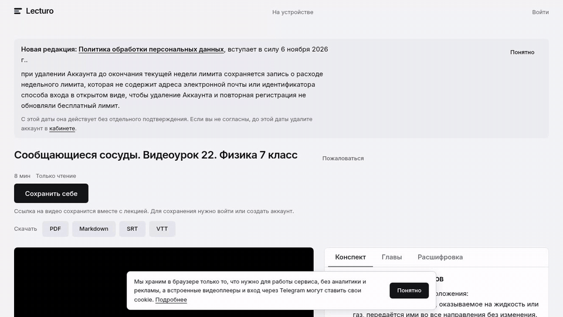
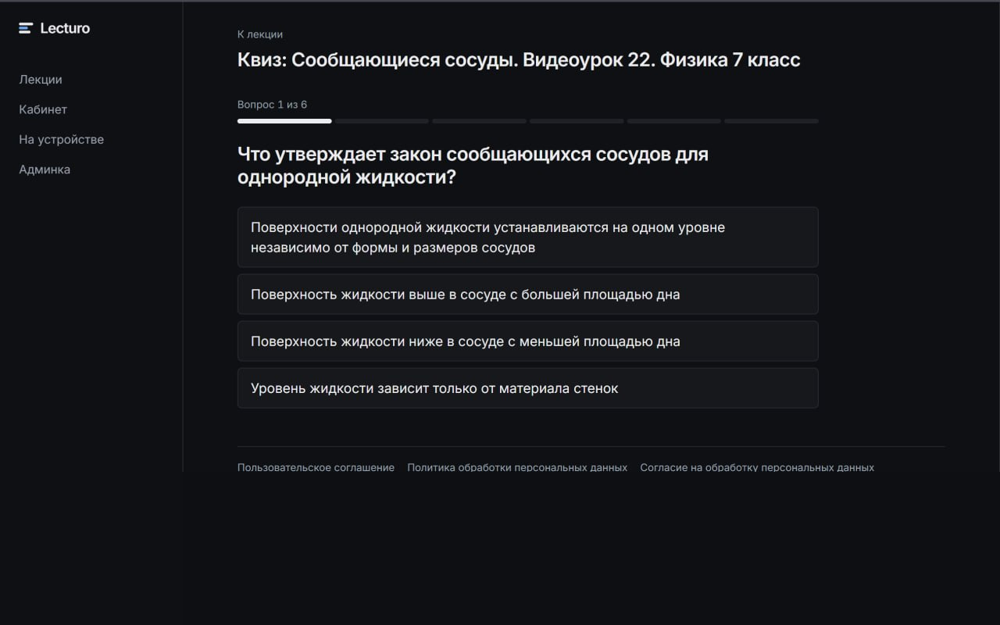
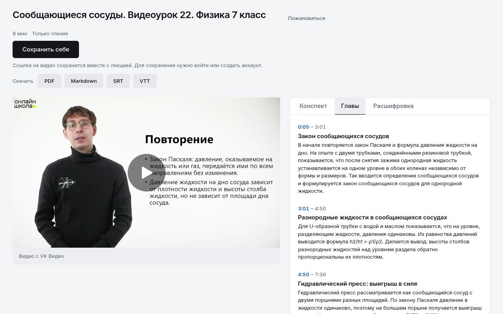
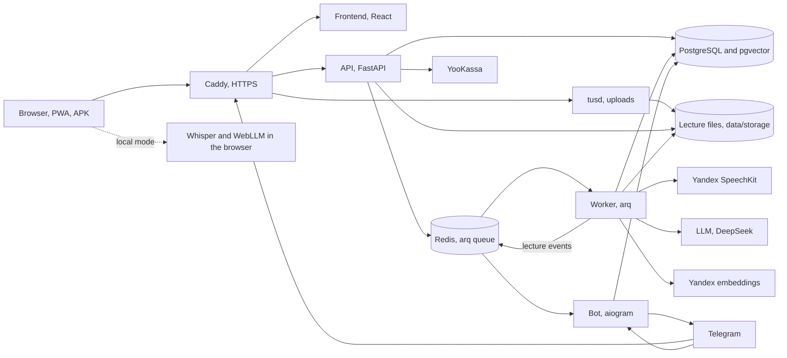

<div align="center">


<h1>Lecturo</h1>

<p>Turns lecture videos into a timestamped transcript, chapters, notes, a quiz and an exam cheat sheet.</p>

<p>
<a href="https://lecturo.ru"></a>
<a href="docs/README.md"></a>
<a href="docs/deploy.md"></a>
<a href="https://t.me/lecturo_notes_bot"></a>
<a href="https://github.com/DedAlexevich/Lecturo/issues/new/choose"></a>
</p>

<p>
<a href="https://github.com/DedAlexevich/Lecturo/actions/workflows/ci.yml"></a>
<a href="LICENSE"></a>


</p>

<p><a href="README.md">Русский</a></p>

</div>

## What it is

Lecturo helps you study from lecture recordings. Upload a video file or paste a link, and the service transcribes the speech and builds study materials from it. Lectures are grouped into courses that you can search and turn into an exam cheat sheet. The interface is in Russian.

- Timestamped transcript: click a phrase to jump to that moment in the video.
- Chapters and notes with LaTeX formulas and highlighted blocks for definitions, theorems, examples and key remarks.
- A quiz for each lecture, every question links to the moment in the video.
- An exam cheat sheet for the whole course.
- Semantic and keyword search across all lectures, chapters and notes.
- Export to PDF, SRT and VTT.
- Public links to share a lecture or a course.
- Local mode: speech recognition (Whisper) and notes (WebLLM) run in the browser, the video never leaves the device. It is free.
- Telegram Mini App and bot: sign in with Telegram and get notified when a lecture is ready.
- Installable as a PWA, APK for Android.

Server-side recognition uses Yandex SpeechKit, notes and quizzes are written by an LLM (DeepSeek or another OpenAI-compatible service), search uses Yandex embeddings. Payments go through YooKassa. A chat about the lecture is in progress ([#306](https://github.com/DedAlexevich/Lecturo/issues/306)).

## Screenshots

<div align="center">
<a href="https://lecturo.ru"></a>
</div>

<table>
<tr>
<td width="50%"><p align="center">Lecture page</p></td>
<td width="50%"><p align="center">Notes with formulas</p></td>
</tr>
<tr>
<td width="50%"><p align="center">Quiz</p></td>
<td width="50%"><p align="center">Answer explanation with a link to the lecture moment</p></td>
</tr>
<tr>
<td width="50%"><p align="center">Chapters with timecodes</p></td>
<td width="50%"><p align="center">Local mode</p></td>
</tr>
</table>

## Architecture



## Stack

| Part | Tools |
|---|---|
| Backend | Python 3.12, FastAPI, SQLAlchemy, Alembic, arq |
| Storage | PostgreSQL 16 with pgvector, Redis |
| Frontend | React 18, TypeScript, Vite, KaTeX, vite-plugin-pwa |
| In the browser | Whisper via Transformers.js, WebLLM |
| Bot | aiogram 3 |
| Providers | Yandex SpeechKit, DeepSeek or another OpenAI-compatible LLM, Yandex embeddings |
| Payments | YooKassa |
| Infrastructure | Docker Compose, Caddy, tusd, GitHub Actions |
| Android | Trusted Web Activity, Bubblewrap |

## Quick start

You need Docker and Docker Compose.

```
cp .env.example .env
docker compose up --build
```

The site runs at http://localhost, the API docs at http://localhost/api/docs.

By default the speech, LLM and embeddings providers run in `stub` mode and return test data, no keys needed. To use real providers set `STT_PROVIDER`, `LLM_PROVIDER`, `EMBEDDINGS_PROVIDER` and the keys in `.env`, see [docs/env.md](docs/env.md).

## Self-hosting

The same `docker compose` setup runs on a server. Put your domain into `SITE_ADDRESS` and Caddy will get a certificate. Server setup, auto-deploy, mail, monitoring and backups are described in [docs/deploy.md](docs/deploy.md). Data lives in `data/` next to the project ([docs/data.md](docs/data.md)), logs in `data/logs` ([docs/logs.md](docs/logs.md)), daily database dumps in `data/backups` ([docs/backups.md](docs/backups.md)).

## Documentation

The index is [docs/README.md](docs/README.md). The documents are in Russian.

## Team

[@DedAlexevich](https://github.com/DedAlexevich) (owner), [@AxellorWave](https://github.com/AxellorWave), [@aaaa24](https://github.com/aaaa24), [@vamaria06-ux](https://github.com/vamaria06-ux), [@elizazha](https://github.com/elizazha).

## License

AGPL-3.0, see [LICENSE](LICENSE).
